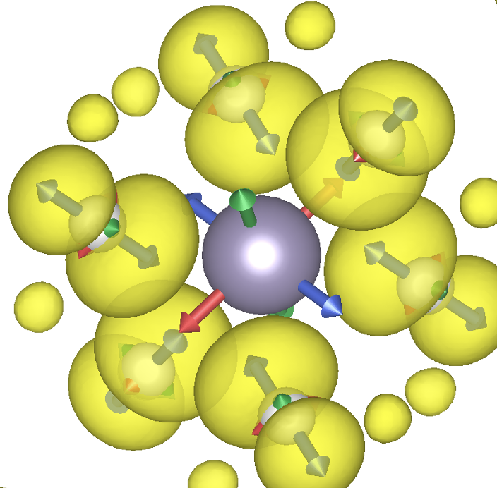

# GIPAW Tensor Diagonalization Tool

`diag_tensor_gipaw_scf.py` reads **g-tensors** and **hyperfine A-tensors** directly from a Quantum ESPRESSO `gipaw.x` output file, diagonalizes them, and prints the principal values and principal axes in a form suitable for visualization in **VESTA**.

The script supports two ways to define the simulation-cell axes:

1. Read the lattice vectors automatically from a Quantum ESPRESSO `pw.x` input file (`scf.in`).
2. Enter the lattice vectors manually on the command line.

---

## Requirements

- Python 3
- NumPy

Install NumPy if needed:

```bash
pip install numpy
```

---

## Basic usage

```bash
python diag_tensor_gipaw_scf.py gipaw.out
```

The script automatically detects whether the `gipaw.x` output contains:

- a **g-tensor**, or
- **hyperfine A-tensors**.

For VESTA conversion, however, the lattice vectors must be known. The recommended method is to provide the corresponding `pw.x` input file.

---

# 1. Recommended mode: read lattice vectors from `scf.in`

## g-tensor

```bash
python diag_tensor_gipaw_scf.py g-tensor.out --qe-input scf.in
```

The script:

1. reads the **last** `Delta_g total` tensor printed by `gipaw.x`,
2. symmetrizes the tensor,
3. diagonalizes it,
4. prints the principal values and normalized principal axes,
5. converts the principal axes to lattice-vector coordinates `(u,v,w)`,
6. prints VESTA-ready vectors.

The last `Delta_g total` block is used because `gipaw.x` may print more than one version of the total g-tensor.

---

## Hyperfine A-tensor

```bash
python diag_tensor_gipaw_scf.py hyperfine.out --qe-input scf.in
```

By default, the script processes atoms **1 through 7**.

This is useful, for example, for a defect calculation in which:

- atom 1 is the defect atom (e.g. Sn),
- atoms 2-7 are its six nearest-neighbor carbon atoms.

The full hyperfine tensor is constructed as

$$A_{\mathrm{total}} =
A_{\mathrm{dipolar}}^{\mathrm{sym}}
+
A_{\mathrm{FC}} I
$$

where:

- `A_dipolar(sym)` is taken from the last

```text
total dipolar (symmetrized)
```

block,

- `A_FC` is taken from the `total` column of the

```text
Fermi contact
```

table.

The resulting total A-tensor is diagonalized separately for each selected atom.

---

## Selecting specific atoms

By default, atoms 1-7 are processed.

Therefore these two commands are equivalent:

```python diag_tensor_gipaw_scf.py hyperfine.out --qe-input scf.in```

```python diag_tensor_gipaw_scf.py hyperfine.out --qe-input scf.in --atoms 1-7```

To process a different set of atoms, specify another range, for example:

```--atoms 1-12```

Individual atoms can also be selected:

```bash
python diag_tensor_gipaw_scf.py hyperfine.out \
    --qe-input scf.in \
    --atoms 1,2,5
```

---

## Supported `CELL_PARAMETERS` formats

The script can read:

```text
CELL_PARAMETERS angstrom
```

```text
CELL_PARAMETERS bohr
```

```text
CELL_PARAMETERS alat
```

For `alat`, the script determines the lattice constant from either:

```text
A = ...
```

or

```text
celldm(1) = ...
```

The lattice vectors are internally converted to Angstrom.

Example:

```text
CELL_PARAMETERS angstrom
10.701  0.000  0.000
0.000  10.701  0.000
0.000  0.000  10.701
```

---

# 2. Manual mode: enter lattice vectors explicitly

If the original `scf.in` file is not available, the lattice vectors can be supplied manually.

General syntax:

```bash
python diag_tensor_gipaw_scf.py gipaw.out \
    --a ax ay az \
    --b bx by bz \
    --c cx cy cz
```

For example, for a cubic cell with lattice constant 10.701 Å:

```bash
python diag_tensor_gipaw_scf.py g-tensor.out \
    --a 10.701 0 0 \
    --b 0 10.701 0 \
    --c 0 0 10.701
```

For hyperfine:

```bash
python diag_tensor_gipaw_scf.py hyperfine.out \
    --a 10.701 0 0 \
    --b 0 10.701 0 \
    --c 0 0 10.701 \
    --atoms 1-7
```

The manual vectors should correspond to the same simulation cell used in the original `pw.x` calculation.

---

# Crystallographic axis definitions

By default, the script uses

```text
z = c
y = b
```

which corresponds to

```bash
--iz 0 0 1
--iy 0 1 0
```

The vectors are defined as integer combinations of the lattice vectors:

$$
z = i_a a + i_b b + i_c c
$$

$$
y = j_a a + j_b b + j_c c
$$

For example:

```bash
--iz 1 1 1
```

defines the crystallographic z-axis along

$$
a+b+c
$$

which corresponds to the `[111]` direction for a cubic cell.

Example:

```bash
python diag_tensor_gipaw_scf.py g-tensor.out \
    --qe-input scf.in \
    --iz 1 1 1 \
    --iy 0 1 -1
```

The x-axis is then constructed automatically from the chosen y and z directions.

---

# Forcing the tensor type

Normally the script automatically detects the calculation type.

If necessary, it can be forced manually.

For a g-tensor:

```bash
python diag_tensor_gipaw_scf.py gipaw.out \
    --type g \
    --qe-input scf.in
```

For hyperfine:

```bash
python diag_tensor_gipaw_scf.py gipaw.out \
    --type A \
    --qe-input scf.in
```

---

# Output

For each tensor, the script prints:

- the tensor used for diagonalization,
- principal values,
- normalized principal axes in Cartesian coordinates,
- `theta` and `phi` angles,
- lattice-coordinate directions `(u,v,w)`,
- positive and negative VESTA vectors,
- orthogonality checks for the eigenvectors.

For hyperfine calculations, the same information is printed separately for every selected atom.

---

# Typical workflow

## g-tensor

```bash
pw.x < scf.in > scf.out
gipaw.x < gipaw_g.in > g-tensor.out

python diag_tensor_gipaw_scf.py g-tensor.out \
    --qe-input scf.in
```

## Hyperfine

```bash
pw.x < scf.in > scf.out
gipaw.x < gipaw_hf.in > hyperfine.out

python diag_tensor_gipaw_scf.py hyperfine.out \
    --qe-input scf.in \
    --atoms 1-7
```

---

# Notes

- The script uses `numpy.linalg.eigh`, which is designed for real symmetric matrices.
- Tensors are symmetrized before diagonalization.
- For the g-tensor, the last `Delta_g total` block is used.
- For hyperfine calculations, the full tensor includes both the symmetrized dipolar contribution and the total Fermi-contact contribution.
- If `--qe-input` is supplied, lattice vectors are read from that file.
- If `--qe-input` is not supplied, lattice vectors can be given manually using `--a`, `--b`, and `--c`.
- The default hyperfine atom selection is `1-7`.

---

# Help

Display all command-line options:

```bash
python diag_tensor_gipaw_scf.py --help
```

# [diag_tensor_gipaw_vesta_cartesian.py](diag_tensor_gipaw_vesta_cartesian.py)

Simplified Python script for analyzing EPR g-tensors and hyperfine tensors from Quantum ESPRESSO GIPAW calculations.

- Uses a single Cartesian coordinate system consistent with QE and reads lattice vectors from QE input files.
- Diagonalizes symmetric tensors to obtain principal values and eigenvectors.
- Constructs HFI tensors from Fermi-contact and spin-dipolar contributions.
- Generates VESTA files with bidirectional principal-axis vectors (±) attached to atoms. For that you need to prepare .vesta file with necessary view, then the script will modify it by adding double arrows.

How to use:

Prepare .vesta file with necessary view and then

```
python diag_tensor_gipaw_vesta_cartesian.py g-tensor.out \
    --qe-input scf.in \
    --vesta-template d.spin.vesta \
    --vesta-output g_tensor.vesta \
    --vesta-length-mode normalized
```

VESTA Vector Length Modes:
- normalized — Vector lengths are proportional to the absolute eigenvalues, normalized to the largest eigenvalue of each tensor. Useful for visualizing tensor anisotropy.
- direction — All vectors have equal lengths, regardless of eigenvalues. Useful for comparing principal-axis orientations, particularly under different strain conditions.


